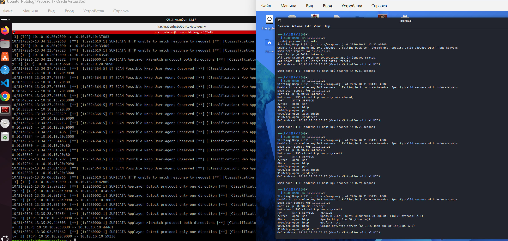
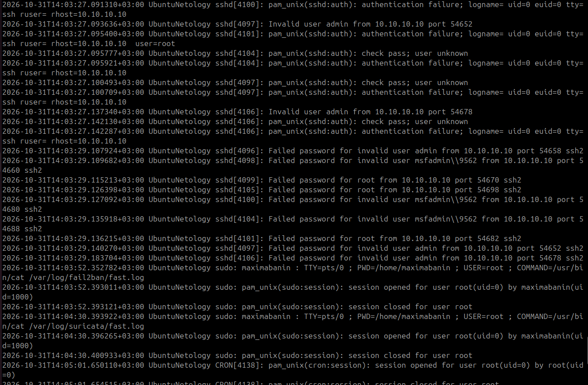
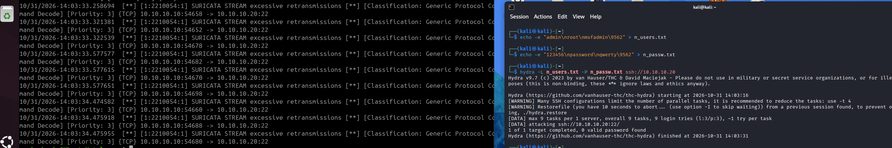
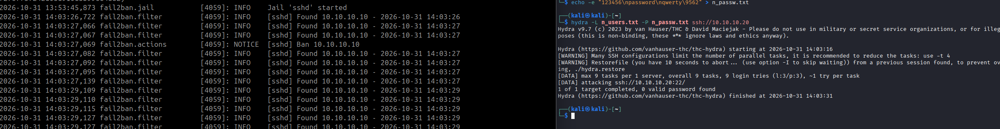

# Домашнее задание к занятию «Защита сети» - Абанина Максима

## Подготовка к выполнению заданий
Подготавливаемой защитной системы:
- установите Суриката;
- установите Fail2Ban.
Подготовка системы злоумышленника: установите nmap и thc-hydra либо скачайте и установите Kali Linux .
Обе системы должны находиться в одной подсети.

## Задание 1
Проведите разведку системы и определите, какие сетевые службы запущены в защищенной системе:
sudo nmap -sA <ip-адрес>
sudo nmap -sT <ip-адрес>
sudo nmap -sS <ip-адрес>
sudo nmap -sV <ip-адрес>

В качестве ответа пришлите события, которые появились в логах Suricata и Fail2Ban, прокомментируйте результат.

Разделение ответственности:
Эксперимент наглядно демонстрирует разницу между сетевой безопасностью и безопасностью на уровне приложений. Suricata эффективно обнаружила все виды сетевого сканирования (-sA, -sT, -sS, -sV), так как анализирует аномалии в заголовках TCP-пакетов;
Слепая зона Fail2Ban: Fail2Ban оказался "слеп" к чистому сетевому сканированию (-sA, -sT, -sS, -sV), потому что оно не генерирует записей об ошибках аутентификации в системных логах. Это нормальное поведение: Fail2Ban предназначен для защиты от брутфорса, а не от картографирования сети.
Вывод: Для полноценной защиты необходима эшелонированная оборона (Defense in Depth). Suricata блокирует/детектирует разведку на раннем этапе, а Fail2Ban защищает конкретные службы от подбора учетных данных, если злоумышленник перейдет от разведки к активной атаке.

## Задание 2
Проделайте атаку на настройку пароля для службы SSH:
hydra -L users.txt -P pass.txt < ip- нов > ssh
гидра:​
создайте два файла: user.txt и pass.txt ;
В каждой строчке первого файла должны быть имена пользователей, второго — пароли. В нашем случае это могут быть случайные строки, но ради эксперимента можно добавить имя и пароль существующего пользователя.
Включение защиты SSH для Fail2Ban:
открыть файл /etc/fail2ban/jail.conf, найти секцию ssh, установить включено в true .
В качестве ответа пришлите события, которые появились в логах Suricata и Fail2Ban, прокомментируйте результат.

Результаты атаки брутфорс на SSH:
1. Зафиксированы множественные неудачные попытки входа с IP 10.10.10.10 (Kali Linux) для пользователей admin, root, msfadmin. SSH-демон корректно регистрировал каждую попытку как Failed password и Invalid user, что является необходимым условием для работы Fail2Ban.
2. Зафиксированы алерты SURICATA STREAM excessive retransmissions — система обнаружила аномально высокую частоту TCP-соединений на порт 22, что характерно для автоматизированной атаки перебора.

Вывод: Обе системы защиты сработали корректно. Suricata обнаружила атаку на сетевом уровне по аномалиям TCP-трафика, а Fail2Ban проанализировал логи приложения SSH и автоматически заблокировал IP-адрес атакующего после превышения порога неудачных попыток (maxretry).

